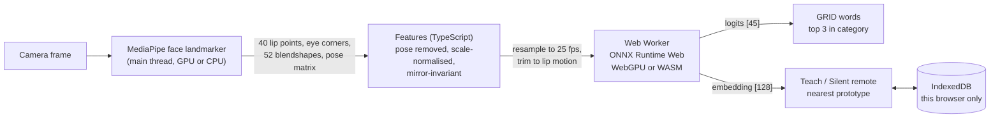
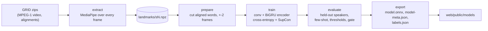

# SilentSpeak

Live silent-word lip reading in the browser. Mouth a word without making a
sound, and a small model reads it from the motion of your lips. Face landmarks
and the model both run on your device; the video never leaves it.

**[Try it live](https://shashank11yadav.github.io/SilentSpeak/)**: allow the
camera, hold Space, mouth a word, release. No camera? Use the Replay clips.

<!-- gif -->

## What you can do

- **GRID words.** Pick a category (commands, colours, prepositions, letters,
  digits, adverbs) and mouth one of its words. You get the top three guesses
  and the accuracy that category reached on speakers the model never saw.
  Categories below the accuracy bar are hidden (see [Results](#results)).
- **Teach your own words.** Record three takes each of any words ("play",
  "pause", "next"). New attempts are matched against your takes by the
  model's lip-motion embedding, so this works for your face and your way of
  speaking, including words that are not in GRID. About a minute to set up.
- **Silent remote.** Map three taught words to play/pause, next and previous,
  and drive a small player with no hands and no voice: in a library, a loud
  room, or with your hands full.
- **Replay.** Six short held-out GRID clips (mouth region plus landmarks) run
  through exactly the same features and model as a live capture, for visitors
  without a camera.

When the model is not confident it says **Not sure** instead of guessing. The
thresholds are calibrated on validation speakers, not tuned by eye.

## Why landmarks, not pixels

The model never sees an image. MediaPipe's face landmarker turns every frame
into 478 3D points, and SilentSpeak keeps the 40 on the lips plus the outer
eye corners. That choice drives everything else:

- **It generalises from a studio corpus to a webcam.** Coordinates do not
  depend on lighting, skin tone, background or camera quality the way pixels
  do. Head pose is removed with the face's transformation matrix and sizes are
  divided by the eye distance, so a turned or distant face reads the same.
- **A mirrored webcam reads the same as the training video.** Each left/right
  pair of lip points is folded into one symmetric feature, so the features are
  identical for a face and its mirror image (a test checks this).
- **It is small and private.** The model has 1.9 M parameters (7.6 MB of
  ONNX), trains on a laptop GPU, and runs in a Web Worker. No frame is
  uploaded anywhere.

The trade-off is honest: landmarks lose the tongue and teeth that pixel models
can see, so look-alike sounds (b, p, m) are hard. This is why the demo leans
on categories and on teaching your own words.

### About GRID

The [GRID corpus](https://doi.org/10.5281/zenodo.3625687) has 33 speakers
with video, each reading 1000 sentences from one fixed grammar:
`command colour preposition letter digit adverb`, for example "bin blue at f
two now". Its vocabulary is 51 words. A model trained on it knows those words
only, which is why "GRID words" offers them by category and why open
vocabulary comes from "Teach your own words" instead.

## How it works



Training is the same feature code in Python, checked against the TypeScript
version on a shared fixture to 1e-4:



**Features.** Per frame: the 18 left/right lip pairs folded into
(half-width, mean height, mean depth), the y and z of the 4 midline points,
16 mouth blendshapes (left/right twins summed), and a face-present flag: 79
values. Frame-to-frame deltas make it 157. A frame with no face, or with two
faces, is all zeros.

**Model.** A linear projection, three residual temporal convolutions, a
two-layer bidirectional GRU, attention pooling and a projection to a
128-dimensional L2-normalised embedding. The 45 logits are a scaled cosine
between the embedding and one learned vector per trained word, so classifier
and prototypes share one space. The loss is cross-entropy plus 0.5 x
supervised contrastive loss, which is what makes the embedding useful for
words it was never trained on.

**Capture.** While the button is held, frames are recorded with their
timestamps, resampled to 25 fps, and trimmed to where the lips actually move
(plus two frames each side, as in training). Captures that are too short, show
no lip motion, or lose the face for most frames are rejected with a "say it
again" message rather than guessed.

## Results

<!-- metrics -->

Every number above comes from `pipeline/reports/metrics.json`, written by
`uv run silentspeak evaluate`. Splits are by speaker: test {s1, s2, s20, s22,
s34}, validation {s3, s4, s23}, the rest train (s21 has no video). Six words
(set, white, with, k, seven, soon) are held out of training entirely and used
only for the few-shot evaluation: 6-way, 5-shot nearest prototype, 1000
episodes, support and queries from one held-out speaker.

**Category gate.** A category is shown in "GRID words" only if its held-out
top-1 is at least 40%. If none pass, the demo opens on "Teach your own words".

## Model card

- **Data:** GRID audio-visual corpus (Cooke, Barker, Cunningham and Shao),
  CC BY 4.0. 33 speakers with video, studio conditions, frontal faces, British
  English.
- **Intended use:** a demonstration of lip reading from landmarks, isolated
  words, a cooperative user facing the camera. Personal, hands-free and
  sound-free control with taught words.
- **Not for:** transcribing speech, reading anyone without consent,
  accessibility-critical input, or any decision about a person.
- **Limitations:** a closed 51-word vocabulary for "GRID words"; look-alike
  sounds (b/p/m, f/v) are confused; training speakers are few and from one
  recording setup, so accuracy for other faces, accents, beards, glasses or
  poor lighting may be lower than the held-out figures; profile views and
  strong head turns break landmark tracking.
- **Known failure cases:** mouthing too fast or too small (rejected as no
  motion), a second face in view (refused), the mouth leaving the frame
  (flagged), and words that look alike in "Teach your own words" (reported as
  not sure).

## Privacy

There is no server. The page is static files on GitHub Pages with a strict
Content-Security-Policy (`'self'` only, plus `'wasm-unsafe-eval'` for
WebAssembly). MediaPipe's WASM and model, ONNX Runtime and the lip model are
all served from this site, so the page makes no third-party request. The
camera starts only when you click, and stops when the tab is hidden. Taught
words are stored in this browser's IndexedDB as embeddings (128 numbers per
take), never as video, and **Clear all** deletes them.

## Run it locally

### Web app only

Needs Node 22.12 or newer.

```sh
cd web
npm install
npm run dev        # http://localhost:5300/SilentSpeak/
npm test           # unit tests, including the shared parity fixture
npm run build && npm run test:e2e
```

`npm run dev` and `npm run build` first run `scripts/fetch-assets.mjs`, which
copies MediaPipe's WASM from `node_modules` and downloads the face landmarker
model, checking it against a pinned SHA-256.

### Full retrain

Needs [uv](https://docs.astral.sh/uv/) and Python 3.12. The data directory
defaults to `../_datasets/grid` next to the repo, or `$DATA_DIR`, or
`--data-dir`. Download the GRID video zips and `alignments.zip` from
[Zenodo](https://doi.org/10.5281/zenodo.3625687) into `<data-dir>/raw/`, with a
`manifest.tsv` (`key, md5, size, url`) next to `raw/`; a zip is only opened
once its size matches.

```sh
cd pipeline
uv sync
uv run silentspeak extract --workers 6    # landmarks/sN.npz per speaker, resumable
uv run silentspeak prepare                # word segments -> prepared/segments.npz
uv run silentspeak train                  # MPS when available -> runs/default/best.pt
uv run silentspeak evaluate               # reports/metrics.json and metrics.md
uv run silentspeak export                 # web/public/models/
uv run silentspeak replay-clips           # web/public/replay/ from held-out speakers
```

Rough runtimes on an Apple M4 (10 cores, 16 GB):

| Step | Time | Notes |
|---|---|---|
| extract | 30-45 min with 6 workers | about 3.4 ms per frame per worker (decode plus landmarks), 2.5 M frames |
| prepare | 2-5 min | |
| train | 30-60 min | about 95 ms per batch of 256 on MPS, early stopping on validation |
| evaluate | 1-3 min | |
| export, replay-clips | under 1 min | |

Every command reads `configs/default.toml` (fixed seed, speaker split,
few-shot words, model and training settings).
`uv run silentspeak smoke` runs the whole chain on a synthetic corpus in a few
seconds, and `uv run silentspeak export --stub` writes a random-weight model
with the real I/O contract, which is what the app ships until training runs.

### The model contract

| | Name | Type | Notes |
|---|---|---|---|
| Input | `frames` | `float32[1, T, 157]` | T from 5 to 50, 25 fps sequence features |
| Output | `logits` | `float32[1, 45]` | scaled cosine scores, in `model-meta.json` `classes` order |
| Output | `embedding` | `float32[1, 128]` | L2-normalised |

`model-meta.json` carries the feature version, frame rate, frame limits,
classes, prototype thresholds and held-out metrics (`null` for the untrained
preview, which makes the app show a notice). `labels.json` carries the
categories, their words, held-out accuracy, calibrated threshold and whether
each one ships.

## Project layout

```
pipeline/   Python: extraction, features, training, evaluation, ONNX export
  configs/    run configurations (default, smoke)
  reports/    metrics.json and metrics.md from evaluate
shared/     feature-parity fixture checked by both test suites
web/        Vite, React, TypeScript and Tailwind app
  src/ml/     features, capture trimming, decisions (mirrors the pipeline)
  public/     model files and replay clips committed from the pipeline
```

## Credits

- **GRID corpus**: Martin Cooke, Jon Barker, Stuart Cunningham and Xu Shao,
  "An audio-visual corpus for speech perception and automatic speech
  recognition", JASA 2006. Data on
  [Zenodo](https://doi.org/10.5281/zenodo.3625687), **CC BY 4.0**. The replay
  clips are downscaled mouth-region crops of held-out GRID test speakers.
- **MediaPipe** face landmarker (Apache 2.0) and **ONNX Runtime Web** (MIT).
- Related work: LipNet (Assael, Shillingford, Whiteson and de Freitas, 2016)
  reads whole GRID sentences from pixels with a large network. SilentSpeak
  takes a different route: single words from landmarks, small enough for a
  browser tab.

## License

MIT. See [LICENSE](LICENSE). The GRID data and the replay clips derived from it
remain under CC BY 4.0.
