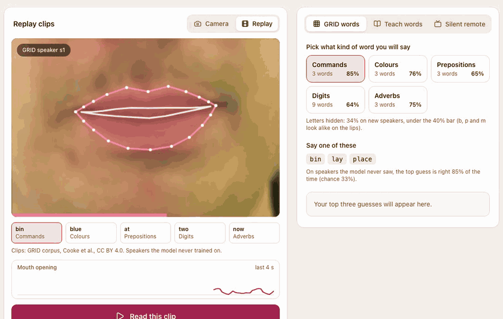
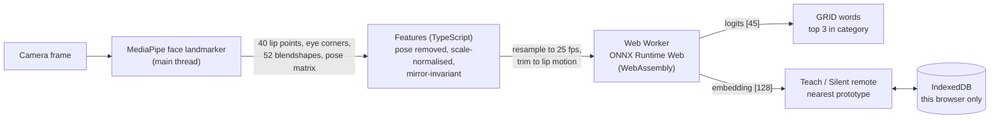
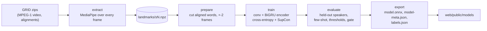

# SilentSpeak

Live silent-word lip reading in the browser. Mouth a word without making a
sound, and a small model reads it from the motion of your lips. Face landmarks
and the model both run on your device; the video never leaves it.

**[Try it live](https://shashank11yadav.github.io/SilentSpeak/)**: allow the
camera, hold Space, mouth a word, release. No camera? Use the Replay clips.



*Replay mode with the trained model on held-out GRID speakers (clips: GRID
corpus, Cooke et al., CC BY 4.0). The "blue" clip is a real miss, read as
"green"; the clips were picked by a fixed rule before training, not by result.*





The first diagram is what runs in the browser; the second is the training
pipeline in `pipeline/`, which shares the feature code (checked against the
TypeScript version, see [Feature parity](#feature-parity)).

## What you can do

- **GRID words.** Pick a category (commands, colours, prepositions, digits,
  adverbs) and mouth one of its words. You get the top three guesses and the
  accuracy that category reached on speakers the model never saw. Letters are
  hidden because they fell below the accuracy bar (see [Results](#results)).
- **Teach your own words.** Record three takes each of any words ("play",
  "pause", "next"). New attempts are matched against your takes by the
  model's lip-motion embedding, so this works for your face and your way of
  speaking, including words that are not in GRID. About a minute to set up.
  On words the model never trained on it picks the right one 78.9% of the
  time from five takes (chance 16.7%), which is the evidence this mode rests
  on.
- **Silent remote.** Map three taught words to play/pause, next and previous,
  and drive a small player with no hands and no voice: in a library, a loud
  room, or with your hands full.
- **Replay.** Short clips of held-out GRID speakers (mouth region plus
  landmarks) run through exactly the same features and model as a live
  capture, for visitors without a camera. Six clips are bundled, one per
  category; the letter clip is not offered while letters are hidden.

When the model is not confident it says **Not sure** instead of guessing. The
thresholds are calibrated on validation speakers, not tuned by eye.

## Why landmarks, not pixels

The model never sees an image. MediaPipe's face landmarker turns every frame
into 478 3D points, and SilentSpeak keeps the 40 on the lips plus the outer
eye corners. That choice drives everything else:

- **It generalises from a studio corpus to a webcam.** Coordinates do not
  depend on lighting, skin tone, background or camera quality the way pixels
  do. Head pose is removed with the face's transformation matrix and sizes are
  divided by the eye distance, so a turned or distant face reads the same.
- **A mirrored webcam reads the same as the training video.** Each left/right
  pair of lip points is folded into one symmetric feature, so the features are
  identical for a face and its mirror image (a test checks this).
- **It is small and private.** The model has 1.9 M parameters (7.6 MB of
  ONNX), trains on a laptop GPU, and runs in a Web Worker. No frame is
  uploaded anywhere.

The trade-off is honest: landmarks lose the tongue and teeth that pixel models
can see, so look-alike sounds (b, p, m) are hard. This is why the demo leans
on categories and on teaching your own words.

### About GRID

The [GRID corpus](https://doi.org/10.5281/zenodo.3625687) has 33 speakers
with video, each reading 1000 sentences from one fixed grammar:
`command colour preposition letter digit adverb`, for example "bin blue at f
two now". Its vocabulary is 51 words. A model trained on it knows those words
only, which is why "GRID words" offers them by category and why open
vocabulary comes from "Teach your own words" instead.

## How it works

The two diagrams at the top give the overall flow. The details:

**Features.** Per frame: the 18 left/right lip pairs folded into
(half-width, mean height, mean depth), the y and z of the 4 midline points,
16 mouth blendshapes (left/right twins summed), and a face-present flag: 79
values. Frame-to-frame deltas make it 157. A frame with no face, or with two
faces, is all zeros.

**Model.** A linear projection, three residual temporal convolutions, a
two-layer bidirectional GRU, attention pooling and a projection to a
128-dimensional L2-normalised embedding. The 45 logits are a scaled cosine
between the embedding and one learned vector per trained word, so classifier
and prototypes share one space. The loss is cross-entropy plus 0.5 x
supervised contrastive loss, which is what makes the embedding useful for
words it was never trained on.

**Capture.** While the button is held, frames are recorded with their
timestamps, resampled to 25 fps, and trimmed to where the lips actually move
(plus two frames each side, as in training). Captures that are too short, show
no lip motion, or lose the face for most frames are rejected with a "say it
again" message rather than guessed.

**Runtime.** The lip model runs on ONNX Runtime Web's WebAssembly build in a
Web Worker, single-threaded (GitHub Pages cannot enable cross-origin
isolation). There is no WebGPU path: the model is small, its GRU has no WebGPU
kernel and would fall back to the CPU anyway, and the WebGPU runtime adds a
28 MB wasm file. Importing `onnxruntime-web/wasm` instead of the default
bundle cut the built site from 66 MB to 52 MB (most of what remains is
MediaPipe's two wasm builds and the two models), and the build now fails if a
WebGPU runtime file is emitted again.

### Feature parity

Training features come from Python and live features from TypeScript, so the
two are checked against each other twice:

- **Same inputs, same numbers.** `shared/fixtures/features.json` holds
  synthetic landmark frames, including a mirrored frame and a 30 fps to 25 fps
  resampling case. pytest and Vitest both reproduce the expected features to
  1e-4.
- **Same frames, same landmarks.** `shared/fixtures/grid-frames/` holds ten
  real frames of held-out speaker s1 (utterance bbaf2n, picked to span a
  closed to a wide-open mouth) as lossless PNGs, with what the Python
  landmarker and `frame_features` make of them (`uv run silentspeak
  frame-fixture`). A Playwright test runs the browser's MediaPipe on the same
  PNGs, converts the result with the app's own code (including MediaPipe's
  column-major pose matrix) and computes features with `features.ts`.

Worst differences over the ten frames, browser against Python, both in IMAGE
mode:

| Browser delegate | Landmarks | Pose rotation | Lip geometry | Blendshapes | Tolerance (geometry, blendshapes) |
|---|---:|---:|---:|---:|---|
| CPU (WebAssembly) | 7e-6 | 3e-5 | 2e-5 | 2e-4 | 1e-3, 5e-3 |
| GPU (WebGL) | 2.4e-3 | 1.0e-2 | 7.1e-3 | 6.1e-2 | 2e-2, 1.5e-1 |

Landmarks are in MediaPipe's normalised image units, geometry in eye-distance
units (a lip half-width is about 0.4) and blendshapes on their 0 to 1 scale.
The CPU tolerances leave room for other processors; the GPU delegate, which
the live camera tries first, runs the network at reduced precision and gets
looser bounds. The check is sharp enough to matter: reading the pose matrix
in the wrong layout moves the lip geometry by up to 0.012, twelve times the
CPU tolerance, and the test asserts that too. It found no bug; the
column-major conversion had only been unit-tested before. As a last
end-to-end check, the six bundled replay clips give the same category
probabilities in the browser as in Python's onnxruntime.

## Results

<!-- metrics -->

Held-out test speakers s1, s2, s20, s22 and s34, 29,997 word segments.

| Category | Words | Top-1 | Top-3 | Chance top-1 | Chance top-3 | Shipped |
|---|---:|---:|---:|---:|---:|:---:|
| Commands (bin, lay, place) | 3 | **84.9%** | 100% | 33.3% | 100% | yes |
| Colours (blue, green, red) | 3 | **75.6%** | 100% | 33.3% | 100% | yes |
| Adverbs (again, now, please) | 3 | **75.1%** | 100% | 33.3% | 100% | yes |
| Prepositions (at, by, in) | 3 | **64.9%** | 100% | 33.3% | 100% | yes |
| Digits (zero to nine, without seven) | 9 | **64.4%** | 86.3% | 11.1% | 33.3% | yes |
| Letters (a to z, without k and w) | 24 | 33.7% | 63.8% | 4.2% | 12.5% | **no** |

<!-- /metrics -->

Top-1 is the share of words whose first guess is right when the model chooses
only among the words of the chosen category. In a three-word category top-3
is trivially 100%; top-1 is the number to read. Across all 45 trained words
at once, on 24,316 test segments, top-1 is 45.9% and top-5 80.7%.

**Which categories ship.** A category appears in "GRID words" only if its
held-out top-1 is at least 40% (the gate was fixed before training). Five of
six pass. **Letters do not**: 33.7% is eight times chance but below the bar.
Spelled letters are short and many of them look alike on the lips: b, p and m
all close the lips the same way, and the difference between them is voicing
and nasality, which happen out of sight. The app says so next to the
categories instead of offering letters, and Replay does not offer the letter
clip. The demo still opens on "GRID words", because at least one category
passed.

**Few-shot: the evidence for "Teach your own words".** Six words (set, white,
with, k, seven, soon) were held out of training entirely. In 1000 episodes of
6-way, 5-shot nearest-prototype matching, with support and query takes from
one held-out test speaker, the right word is picked **78.9%** of the time
(chance 16.7%). That is a fair stand-in for a visitor teaching their own
words: new speaker, new words, five takes. The quick setup uses three takes,
so expect a little less; adding takes helps.

**"Not sure".** Each category has a confidence threshold calibrated on the
validation speakers for 75% precision, and "Teach your own words" has a
similarity and margin threshold calibrated the same way. Below them the app
says "Not sure" rather than guess.

Every number above comes from `pipeline/reports/metrics.json` (and its table
`pipeline/reports/metrics.md`), written by `uv run silentspeak evaluate`.
Splits are by speaker: test {s1, s2, s20, s22, s34}, validation {s3, s4,
s23}, and the other 25 speakers with video train (s21 has no video).

### Lessons learned: a third of the data was silently missing

The first full run trained on 14 speakers instead of 25. The pipeline matched
each alignment folder to a speaker's video zip by its name, and in the Zenodo
GRID archive **19 of the 34 alignment folders carry another speaker's label**
(s5 and s6 are swapped, s20's alignments are filed under s21, which has no
video, and so on). Utterance ids such as `bbaf2n` are unique to a speaker, so
a mislabelled folder's ids matched none of the videos it was paired with and
those utterances were dropped without an error. Nothing crashed; the model
was simply trained on less data.

The fix (commit 2d1d9b4) stops trusting folder names: `read_alignments`
matches each speaker's videos to whichever alignment folder contains the same
utterance ids, and raises an error if no folder covers at least 90% of a
speaker's videos. Before trusting the remapping, it was checked against the
video itself: for the remapped speakers, MediaPipe's jawOpen is 1.6 to 2.6
times higher inside aligned words than in the silences between them, which
would not happen with another speaker's timings. Training segments went from
43,271 to 121,023, and validation top-1 over all words went from 0.41 to
0.52.

The lesson: count what a data loader keeps, per speaker, and fail loudly
when a source yields nothing; and when labels come from a second archive,
validate them against the signal, not just the file names.

### Real runtimes

On an Apple M4 (10 cores, 16 GB), for the full corpus:

| Step | Time | Notes |
|---|---|---|
| extract | about 46 min | 2.47 M frames, 6 worker processes; a face was found in 99.91% of frames |
| prepare | 23 s | 197,254 word segments from 33 speakers; 117 dropped for a missing face, 629 as too short |
| train | about 25 min | MPS, about 78 s per epoch over 121,023 segments; early stopped after 19 epochs, best at epoch 9 |
| evaluate | 47 s | held-out speakers, few-shot episodes, threshold calibration |
| export, replay-clips | 6 s | ONNX export with an onnxruntime check, six replay clips |

## Model card

- **Model:** lip-motion encoder (temporal convolutions, two-layer
  bidirectional GRU, attention pooling), 1.9 M parameters, 7.6 MB ONNX.
  Input: 25 fps sequences of 157 landmark features. Outputs: 45 word logits
  and a 128-d embedding.
- **Data:** the GRID audio-visual corpus (Cooke, Barker, Cunningham and Shao,
  2006), CC BY 4.0, from [Zenodo](https://doi.org/10.5281/zenodo.3625687).
  33 speakers with video, each reading 1000 six-word sentences from one fixed
  grammar in a studio: frontal faces, even lighting, British English. 25
  speakers train, 3 validate, 5 are held out for testing; six words are held
  out of training for the few-shot test.
- **Intended use:** silent commands for a single cooperative user who faces
  the camera and teaches their own words ("Teach your own words", "Silent
  remote"), plus a demonstration of speaker-independent recognition within
  the GRID vocabulary.
- **Not for:** general lip reading or transcription of speech, reading anyone
  who has not chosen to use it, accessibility-critical or safety-critical
  input, or any decision about a person.
- **Performance:** on five speakers the model never saw, 64% to 85% top-1
  within a shipped category (chance 11% to 33%); 45.9% top-1 across all 45
  trained words; 78.9% 6-way 5-shot on words never trained on. See
  [Results](#results).
- **Limitations:**
  - GRID is a fixed-grammar studio corpus. "GRID words" knows the 21 GRID words in
    categories that pass the accuracy bar and nothing else, and accuracy on a webcam in a living room will be lower
    than the held-out studio figures.
  - Speaker-independent accuracy is modest: letters miss the bar entirely,
    and even shipped categories are wrong one time in four or five. The
    headline mode is the one you teach, because it adapts to one face.
  - Look-alike sounds (b/p/m, f/v) are confused; landmarks do not see the
    tongue or teeth.
  - Training faces are few and recorded in one setup, so other faces,
    accents, beards, glasses or poor lighting may do worse. Profile views
    and strong head turns break landmark tracking.
- **Known failure cases:** mouthing too fast or too small (rejected as no
  motion), a second face in view (refused), the mouth leaving the frame
  (flagged), and taught words that look alike (reported as not sure).
- **Privacy:** everything runs on the device; no video, image or landmark is
  uploaded, and taught words are stored only as embeddings in this browser
  (see [Privacy](#privacy)).

## Privacy

There is no server. The page is static files on GitHub Pages with a strict
Content-Security-Policy (`'self'` only, plus `'wasm-unsafe-eval'` for
WebAssembly). MediaPipe's WASM and model, ONNX Runtime and the lip model are
all served from this site, so the page makes no third-party request. The
camera starts only when you click, and stops when the tab is hidden. Taught
words are stored in this browser's IndexedDB as embeddings (128 numbers per
take), never as video, and **Clear all** deletes them.

## Run it locally

### Web app only

Needs Node 22.12 or newer.

```sh
cd web
npm install
npm run dev        # http://localhost:5300/SilentSpeak/
npm test           # unit tests, including the shared parity fixture
npm run build && npm run test:e2e
```

`npm run dev` and `npm run build` first run `scripts/fetch-assets.mjs`, which
copies MediaPipe's WASM from `node_modules` and downloads the face landmarker
model, checking it against a pinned SHA-256.

### Full retrain

Needs [uv](https://docs.astral.sh/uv/) and Python 3.12. The data directory
defaults to `../_datasets/grid` next to the repo, or `$DATA_DIR`, or
`--data-dir`. Download the GRID video zips and `alignments.zip` from
[Zenodo](https://doi.org/10.5281/zenodo.3625687) into `<data-dir>/raw/`, with a
`manifest.tsv` (`key, md5, size, url`) next to `raw/`; a zip is only opened
once its size matches.

```sh
cd pipeline
uv sync
uv run silentspeak extract --workers 6    # landmarks/sN.npz per speaker, resumable
uv run silentspeak prepare                # word segments -> prepared/segments.npz
uv run silentspeak train                  # MPS when available -> runs/default/best.pt
uv run silentspeak evaluate               # reports/metrics.json and metrics.md
uv run silentspeak export                 # web/public/models/
uv run silentspeak replay-clips           # web/public/replay/ from held-out speakers
```

Measured runtimes for each step are in [Real runtimes](#real-runtimes).

Every command reads `configs/default.toml` (fixed seed, speaker split,
few-shot words, model and training settings).
`uv run silentspeak smoke` runs the whole chain on a synthetic corpus in a few
seconds, and `uv run silentspeak export --stub` writes a random-weight model
with the real I/O contract, so the app can run before any training (it then
shows an "untrained preview" notice).

### The model contract

| | Name | Type | Notes |
|---|---|---|---|
| Input | `frames` | `float32[1, T, 157]` | T from 5 to 50, 25 fps sequence features |
| Output | `logits` | `float32[1, 45]` | scaled cosine scores, in `model-meta.json` `classes` order |
| Output | `embedding` | `float32[1, 128]` | L2-normalised |

`model-meta.json` carries the feature version, frame rate, frame limits,
classes, prototype thresholds and held-out metrics (`null` for the untrained
preview, which makes the app show a notice). `labels.json` carries the
categories, their words, held-out accuracy, calibrated threshold and whether
each one ships.

## Project layout

```
pipeline/   Python: extraction, features, training, evaluation, ONNX export
  configs/    run configurations (default, smoke)
  reports/    metrics.json and metrics.md from evaluate
shared/     feature-parity fixture checked by both test suites
web/        Vite, React, TypeScript and Tailwind app
  src/ml/     features, capture trimming, decisions (mirrors the pipeline)
  public/     model files and replay clips committed from the pipeline
```

## Credits

- **GRID corpus**: Martin Cooke, Jon Barker, Stuart Cunningham and Xu Shao,
  "An audio-visual corpus for speech perception and automatic speech
  recognition", JASA 2006. Data on
  [Zenodo](https://doi.org/10.5281/zenodo.3625687), **CC BY 4.0**. The replay
  clips are downscaled mouth-region crops of held-out GRID test speakers.
- **MediaPipe** face landmarker (Apache 2.0) and **ONNX Runtime Web** (MIT).
- Related work: LipNet (Assael, Shillingford, Whiteson and de Freitas, 2016)
  reads whole GRID sentences from pixels with a large network. SilentSpeak
  takes a different route: single words from landmarks, small enough for a
  browser tab.

## License

MIT. See [LICENSE](LICENSE). The GRID data and the replay clips derived from it
remain under CC BY 4.0.
